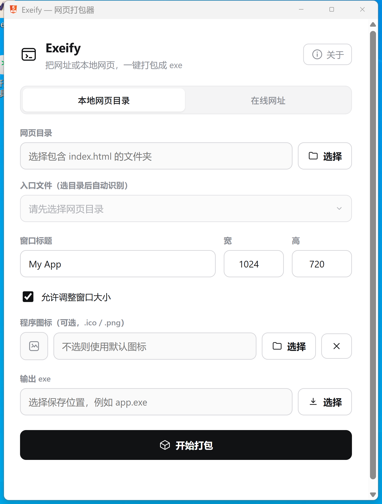

<div align="center">


# Exeify

**把网址或本地网页项目，一键打包成可运行的 Windows exe**

零工具链 · 秒级出包 · 产物仅约 1 MB · 支持 Vite / Vue / React 等框架

<p>
  <a href="LICENSE"></a>
  
  
  
  <a href="https://github.com/zjqzte2010/web2exe/releases"></a>
  <a href="https://github.com/zjqzte2010/web2exe/stargazers"></a>
</p>

给小白用的图形界面工具：选一个在线网址、或一个本地网页文件夹，点一下就得到一个双击即开的 `.exe`。
生成的程序使用 Windows 自带的 WebView2 显示，终端用户无需安装任何东西。



</div>

## 下载

直接取编译好的程序，不用自己装 Rust：

**[⬇ 前往 Releases 下载 v0.2.1](https://github.com/zjqzte2010/web2exe/releases/tag/v0.2.1)**

| 附件 | 说明 |
|---|---|
| `exeify.exe` | 打包器本体（图形界面 + 命令行），1.37 MB，开箱即用 |
| `offline.exe` | 示例：本地网页目录打成的离线 exe |
| `online.exe` | 示例：在线网址打成的 exe |
| `dual.exe` / `dual.apk` | 示例：一次打包同时产出 exe + apk |
| `url.apk` | 示例：只出 APK |

> **关于 APK 签名（重要）**：上面这些 apk 用的是仓库内置的 demo 证书（`CN=Exeify Demo`），私钥就公开在仓库里 —— 任何人拿到它都能签出同包名的包。**只适合自己侧载、内部试用；不要对外分发，更不要上应用商店。**
>
> 当前版本命令行**没有** `--keystore` 之类的参数，APK 密钥固定取 `assets/apk/key.pem`。要换自己的密钥，改源码后重新编译：
>
> ```bash
> # 1) 生成自己的密钥对（Android 用 RSA 2048，有效期自定）
> keytool -genkeypair -v -keystore my-release.jks -alias mykey \
>   -keyalg RSA -keysize 2048 -validity 36500 \
>   -storepass <你的密码> -keypass <你的密码> \
>   -dname "CN=你的公司名, O=你的组织, C=CN"
> # 2) 导出 PKCS#8 私钥（DER）与证书（DER），替换仓库里的两份材料
> keytool -importkeystore -srckeystore my-release.jks -destkeystore my.p12 -deststoretype PKCS12 -srcalias mykey
> openssl pkcs12 -in my.p12 -nocerts -nodes -out my.key.pem
> openssl pkcs8 -topk8 -inform PEM -outform DER -in my.key.pem -out private.der -nocrypt
> openssl req -in <(keytool -exportcert -rfc -keystore my-release.jks -alias mykey -storepass <密码>) -outform DER -out cert.der
> # 3) 用 private.der / cert.der 替换 assets/apk/key.pem（内含的私钥与证书），然后
> cargo build --release
> ```
>
> 已经是 apk 成品、只是要重签，也可以直接用 Android SDK 的 `apksigner sign --ks my-release.jks --ks-key-alias mykey app.apk`；注意重签后本仓库的 `scripts/verify_apk.py` 是按内置证书验签的，会报验签不匹配，这属正常（不代表包坏了），换用 `apksigner verify -v` 校验即可。

## 特点

- **极致轻量**：打包器和产物都只有约 1 MB（对比 Electron ~100 MB、Pake ~10 MB）。
- **秒级出包**：不编译、不联网。选好点一下，一秒钟生成 exe。
- **零工具链**：使用者不用装 Rust / Node；产物在别人电脑上也只依赖系统自带的 WebView2（Win10/11 通常已内置）。
- **双模式**：**在线网址** 和 **本地网页目录** 都支持，本地项目完全离线自包含。
- **自动识别入口**：选好本地目录，自动扫描出网页入口（优先 `index.html`），多个可下拉切换，不用手打路径。
- **自定义图标**：可给产物 exe 换成自己的 `.png` / `.ico`（自动转换、生成多分辨率），支持索引色等各类 PNG。
- **图形界面**：现代极简白，专为不懂命令行的人设计。

## 使用方法（图形界面）

1. 下载并运行 `exeify.exe`。
2. 选择模式：
   - **本地网页目录** —— 选一个包含网页的文件夹；**入口文件会自动识别**（多个时可下拉切换）。
   - **在线网址** —— 填一个 `https://` 开头的网址。
3. 填窗口标题、宽高，勾选是否允许调整窗口大小。
4. *(可选)* 选一个 `.png` / `.ico` 作为产物的**程序图标**（不选则用默认图标）。
5. 选择输出位置（`xxx.exe`），点 **开始打包**。
6. 双击生成的 exe 即可运行。

> 点击左下角「关于」可查看维护者与开源地址。

## 相对 Pake 的差异

| | Pake | **Exeify** |
|---|---|---|
| 打包时要装的东西 | Node.js + Rust + Tauri 工具链 | **无，下载即用** |
| 打包耗时 | 分钟级（真的在编译） | **秒级（不编译，直接生成）** |
| 本地目录 | 支持，但要走完整编译 | **一等公民，秒出** |
| 面向人群 | 开发者 / 命令行 | **小白 / 图形界面** |

> Pake 很棒，主打把在线网址做成精致桌面 App；Exeify 主打 **零门槛、秒出包、本地与网址双支持**。

## 命令行（可选，进阶）

同一个 exe 也内置了隐藏 CLI，方便脚本化：

```bash
# 本地目录 → exe
exeify pack --local <网页目录> [--entry index.html] --out <输出.exe> [--apk <输出.apk>] [选项]
# 在线网址 → exe
exeify pack --url <网址>                        --out <输出.exe> [--apk <输出.apk>] [选项]
# 只出 APK
exeify pack --local <网页目录> --apk <输出.apk>

选项: --title 名称 --width 宽 --height 高 --window normal|maximized|fullscreen
      --no-resizable --icon <.ico|.png> --splash <.png|.jpg> --splash-bg #rrggbb --splash-sec 秒
exeify version   # 打印版本号
```

## 豆包 Skill（给 AI 助手直接调用）

仓库里的 `skill/exeify-web2exe/` 是一个可直接装进豆包技能目录的 Skill：

```
skill/exeify-web2exe/
├── SKILL.md                 # 触发词、参数表、成功/失败判定、验收要求
├── exeify.exe               # 随附的打包器（1.4 MB，离线可用，不用另下载）
├── scripts/verify_apk.py    # 产物 APK 校验脚本（免 Android SDK）
├── references/troubleshooting.md
├── LICENSE / NOTICE         # 二次开发署名（再分发请保留）
```

安装：把 `skill/exeify-web2exe` 整个目录复制到豆包技能根，例如
`C:\Users\admin\Doubao\skills\exeify-web2exe`（本机）或
`<...>\agent_mode\workspace\.user_skills\exeify-web2exe`（工作区）。

装好后在对话里说「把这个网页打包成 exe」「把网址做成桌面程序，顺便出个 apk」即可触发。

## 技术栈

- [wry](https://github.com/tauri-apps/wry) + [tao](https://github.com/tauri-apps/tao) —— 系统 WebView2
- Rust，`zip`（资源打包）/ `rfd`（原生对话框）/ `serde`
- `editpe` + `ico` + `png`（产物图标写入 / PNG→ICO）/ `winresource`（打包器自身图标）

## 从源码构建

需要 Rust（`x86_64-pc-windows-msvc`）：

```bash
cargo build --release
# 产物：target/release/exeify.exe
```

## 运行环境

- **最低要求：Windows 10**（Windows 10 / 11 均支持；不支持 Win7/8）
- [WebView2 运行时](https://developer.microsoft.com/microsoft-edge/webview2/)（Win11 及较新 Win10 已内置，缺失时安装一次即可）

## 许可证与二开须知

本项目基于 **[Apache License 2.0](LICENSE)** 开源。

- 原作者：**不坑老师**，Copyright 2026，原项目 <https://github.com/44886/Exeify>
- 本仓库维护与二次开发：**zjqzte2010**，<https://github.com/zjqzte2010/web2exe>

本仓库是在原项目基础上的二次开发（fork），主要改动：图形界面重构、在线网址与本地目录双模式、
可选同时产出 Android APK、内置图标替换、WebView2 用户数据目录隔离与创建失败自动重试等。
按 Apache-2.0，原作者的署名与许可证声明均已完整保留（见 [`NOTICE`](NOTICE) 与各源码文件头部）。

欢迎二次开发（改造、集成、商用均可），但按 Apache-2.0 的要求，**再分发 / 二开时必须**：

1. 保留 [`LICENSE`](LICENSE) 与 [`NOTICE`](NOTICE) 文件（`NOTICE` 里包含对「不坑老师」的署名，必须原样带上）；
2. 保留源码文件顶部的版权声明；
3. 若你修改了代码，需注明改动。

> 说明：Apache-2.0 要求的是在**源码 / 分发物 / NOTICE** 中保留署名，并不强制在你的成品界面里展示；
> 也允许闭源与商用，只要满足上述署名义务。若你愿意在 App 里保留"关于"页对「不坑老师」的展示，我们非常欢迎 🙏。

## Star History

<a href="https://www.star-history.com/?type=date&repos=zjqzte2010%2Fweb2exe">
 <picture>
   <source media="(prefers-color-scheme: dark)" srcset="https://api.star-history.com/chart?repos=zjqzte2010/web2exe&type=date&theme=dark&legend=top-left" />
   <source media="(prefers-color-scheme: light)" srcset="https://api.star-history.com/chart?repos=zjqzte2010/web2exe&type=date&legend=top-left" />
   
 </picture>
</a>
